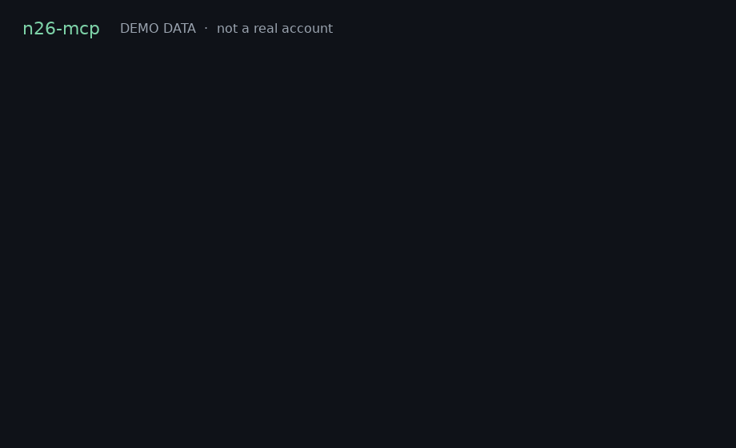

# n26-mcp

**N26 has no AI API, and with PSD2 you don't need one.** A tiny read-only MCP lets your agent read your own N26 account: you approve once in the N26 app, the agent never gets your password, and there is no payment code. MIT.



*Demo data, not a real account. Rendered from `n26-eb demo` on a made-up fixture (Example Hausverwaltung, StreamCo, a weekly veggie box). No bank was contacted, and this is not a recording of a live chat.*

Your transactions are sent to whichever AI model or client you connect. Read-only means this server cannot move money. It does not mean the conversation stays on your machine.

- `n26-mcp`: stdio MCP server for Claude Desktop, Claude Code, Cursor and any other MCP client. It imports `eb.py`. It does not contain a second client.
- `n26-eb`: the same client as a CLI, including `connect` (bank consent) and `demo` (the fixture above).
- `SKILL.md`: an agent skill (Grok Bot, Claude skills, OpenClaw) for when to use it, and the safety rules.

There is **no payment code** in this repo. The consent covers balances and transactions only. A recurring series needs 3 charges (2 for quarterly or yearly). It will miss a yearly bill that has only happened once, and it is not a list of every subscription.

## vs bankmcp

[noskillish/bankmcp](https://github.com/noskillish/bankmcp) is the broader Enable Banking MCP: more banks, more tools, a hosted connector. Use that if you want the larger surface.

This one is small and exercised against N26. The part worth having is the EU rule. PSD2 lets you give an agent legal read access to your own account through a licensed account-information provider (Enable Banking), without the bank shipping an AI API, without your password, and without scraping a private API. You approve in the N26 app. The process runs on your machine. There is no payment code in it.

| | This (PSD2 AIS via Enable Banking) | Unofficial N26 API / scrapers |
|---|---|---|
| Legal basis | EU PSD2 account information through a licensed provider | Reverse-engineered private API |
| Your password | Never shared: you approve in the N26 app | The client needs your login and 2FA |
| Bank terms | The sanctioned route | Breaks N26's terms and can get the account locked |
| Access | Read-only, time-boxed (max 180 days), revocable | Whatever the login can do |
| Where it runs | On your machine | Depends on the scraper |

## What it costs

Enable Banking's restricted production mode is free when you link your own accounts for personal, non-commercial use. The Control Panel and the API under those terms are free of charge. Every user creates **their own** Enable Banking application. Never share an app ID plus key. It is a tool for someone who will be their own developer, not a consumer app you can hand to someone else.

## Setup (about 25 minutes)

Python 3.10+.

1. **Install**
   ```bash
   git clone https://github.com/s-c-h-a-f-e-r/n26-agent-skill && cd n26-agent-skill
   python3 -m venv .venv && . .venv/bin/activate
   pip install -e .
   ```
   Or, without a checkout: `uvx --from git+https://github.com/s-c-h-a-f-e-r/n26-agent-skill n26-eb --help`
2. **Create the Enable Banking app.** Sign up at https://enablebanking.com and open the Control Panel, then **API applications**, new application. The form asks for a description, a privacy-policy URL, a terms-of-service URL and a data-protection email. Restricted mode does not check those URLs, but you should use addresses you control. Environment: **Production**. Redirect URL: `https://enablebanking.com/`. Use: personal.
3. Download the private key (`.pem`) and note the application ID.
4. **First N26 approval.** In the Control Panel, activate the app by linking your own account. That is you approving read access inside N26. Restricted mode only returns data for accounts you have linked. Business use and other people's accounts are out of scope.
5. **Put the key where the installed command can see it.** A checkout looks next to `eb.py`. An install via pip, pipx or uvx looks in `~/.config/n26-mcp` (or `$XDG_CONFIG_HOME/n26-mcp`).
   ```bash
   mkdir -p ~/.config/n26-mcp/keys
   mv ~/Downloads/<your-key>.pem ~/.config/n26-mcp/keys/private.pem
   chmod 600 ~/.config/n26-mcp/keys/private.pem
   export EB_APP_ID=<your-application-id>
   # a checkout can instead use keys/private.pem and config.json, see config.example.json
   # another bank: export EB_BANK="Revolut" EB_COUNTRY=DE
   ```
6. **Check the key, then the second N26 approval.**
   ```bash
   n26-eb application          # key and app ID work
   n26-eb aspsps               # N26 is listed
   n26-eb connect              # prints a link; approve in the N26 app; paste the redirect URL
   ```
   `connect` is `auth` plus `session`. If you are not at a terminal, it prints the link and you finish with `n26-eb session '<the URL you landed on>'`.
7. **Point your MCP client at it** with absolute paths (snippets below). Balances and transactions are cached for the UTC day under `~/.cache/n26-mcp`.

`python eb.py …` still works from a checkout. The installed command is `n26-eb`.

## Rate limits

N26, like many banks under PSD2, allows about **4 unattended balance or transaction fetches per account per day**. Enable Banking treats a call as unattended when it has no [PSU headers](https://enablebanking.com/docs/faq/) (the headers that say a person is at the keyboard). The next one comes back as **HTTP 429**, often `ASPSP_RATE_LIMIT_EXCEEDED`, for about 6 hours.

This client stores each account and date range for the UTC day, mode `0600`, so a chat that asks for a balance, then spending, then subscriptions does not call the bank again. A 429 falls back to the last cached copy when there is one, and the tool says so. `EB_CACHE=0` skips the cache.

When **you** are the one asking, set both of these so the call is marked online. Sending only one of them makes Enable Banking return 422, so neither is sent unless both are set:

```bash
export EB_PSU_IP=<your current IP>
export EB_PSU_USER_AGENT='<the user agent of the browser you are using>'
```

A cron job or other schedule must set `EB_PSU_PRESENT=0` so it does not pretend you are online. Do not poll more than about 4 times a day.

## MCP server

stdio. Claude Desktop, Claude Code and Cursor start it as a local process. Every tool is marked read-only (`readOnlyHint`). There is no payment tool and no consent tool on the server. Connecting the bank stays on `n26-eb connect`, because you approve that in the N26 app.

`get_transactions` follows pagination, then returns the **newest 50** matching rows (200 maximum). Narrow it with `date_from`, `date_to`, `search` (payee or remittance text) and `offset`. For a summary, use `recurring_charges` or the resource `n26://spending/YYYY-MM` instead of asking for every row.

| Tool | What the model gets |
|---|---|
| `list_accounts` | Consented accounts: uid, currency, last 4 IBAN characters. Local session only. |
| `get_balances` | Balance type, amount, currency, reference date. Cached for the day. |
| `get_transactions` | Newest rows in a date range, with `search`, `limit` and `offset`. |
| `recurring_charges` | Cadence, typical amount, next expected date, monthly equivalent, and `lapsed?` when a series has stopped. Needs enough repeats. |
| `consent_status` | Expiry, days left, and a warning. `remote: true` also asks Enable Banking for the session status. |

There is a prompt, `monthly_spending_summary`. Show balances and payees only to yourself.

### Claude Desktop

`claude_desktop_config.json` (macOS: `~/Library/Application Support/Claude/`, Windows: `%APPDATA%\Claude\`, Linux: `~/.config/Claude/`):

```json
{
  "mcpServers": {
    "n26": {
      "command": "uvx",
      "args": ["--from", "git+https://github.com/s-c-h-a-f-e-r/n26-agent-skill", "n26-mcp"],
      "env": {
        "EB_APP_ID": "your-application-id",
        "EB_KEY_PATH": "/absolute/path/to/private.pem",
        "EB_SESSION_PATH": "/absolute/path/to/session.json",
        "EB_PSU_IP": "your-ip",
        "EB_PSU_USER_AGENT": "your-browser-user-agent",
        "EB_BANK": "N26",
        "EB_COUNTRY": "DE"
      }
    }
  }
}
```

### Claude Code

`--transport stdio` has to sit between the last `--env` and the server name, otherwise the name is parsed as another variable.

```bash
claude mcp add \
  --env EB_APP_ID=your-application-id \
  --env EB_KEY_PATH=/absolute/path/to/private.pem \
  --env EB_SESSION_PATH=/absolute/path/to/session.json \
  --env EB_BANK=N26 \
  --env EB_COUNTRY=DE \
  --transport stdio n26 \
  -- uvx --from git+https://github.com/s-c-h-a-f-e-r/n26-agent-skill n26-mcp
```

### Cursor

`.cursor/mcp.json` in the project, or `~/.cursor/mcp.json` for every project. `${env:NAME}` keeps the secret out of the file.

```json
{
  "mcpServers": {
    "n26": {
      "type": "stdio",
      "command": "uvx",
      "args": ["--from", "git+https://github.com/s-c-h-a-f-e-r/n26-agent-skill", "n26-mcp"],
      "env": {
        "EB_APP_ID": "${env:EB_APP_ID}",
        "EB_KEY_PATH": "${env:EB_KEY_PATH}",
        "EB_SESSION_PATH": "${env:EB_SESSION_PATH}",
        "EB_BANK": "N26",
        "EB_COUNTRY": "DE"
      }
    }
  }
}
```

After `pip install -e .`, the same block can use `"command": "n26-mcp"` and no `args`. `python3 -m n26_mcp` works too.

## Consent renewal

N26 consents last at most 180 days. Run `n26-eb status` weekly. Exit 0 means it is fine, exit 2 means it expires within 14 days, exit 3 means it has expired. Renew with `n26-eb connect`. The 4-a-day cap above still applies. The status check itself does not fetch transactions.

## Privacy

- Keys, `config.json`, `session.json`, `data/` and the cache are not for git. The cache is outside the repo, under `~/.cache/n26-mcp`.
- Show balances, transactions and payees only to yourself, never in a shared channel (`SKILL.md`). Do not add this server to a shared Cursor or Claude project if other people can read tool output.
- Your transactions are sent to whichever AI model or client you connect.

## Tests

```bash
python3 -m unittest discover -s tests     # offline; sample/transactions.json and a mocked API
python3 tests/make_sample.py              # regenerate the synthetic sample and the bundled fixture
python3 scripts/make_demo_gif.py          # regenerate docs/demo.gif from that fixture
```

GitHub Actions runs the suite on Python 3.10–3.13 and checks that the package builds (`.github/workflows/tests.yml`).

## Publishing

The PyPI name to claim is `n26-mcp`. Nothing in this repo uploads it.

```bash
python -m pip install build twine
python -m build
twine check dist/*
# twine upload dist/*    # only when you mean to publish
```

`.github/workflows/release.yml` publishes to PyPI when a GitHub Release is published, via trusted publishing. It does not run on pull requests. Create the PyPI project and the GitHub `pypi` environment first.

Until then:

```bash
uvx --from git+https://github.com/s-c-h-a-f-e-r/n26-agent-skill n26-mcp
pipx install git+https://github.com/s-c-h-a-f-e-r/n26-agent-skill
```

## Credits

- [noskillish/bankmcp](https://github.com/noskillish/bankmcp): the leading Enable Banking MCP. This repo is the small, N26-tested, read-only one.
- [Enable Banking API samples](https://github.com/enablebanking/enablebanking-api-samples), which the client is based on.

## Disclaimer

Not affiliated with N26 or Enable Banking. Not financial advice. Check your bank's and Enable Banking's terms before connecting.

## License

MIT, see [LICENSE](LICENSE).
